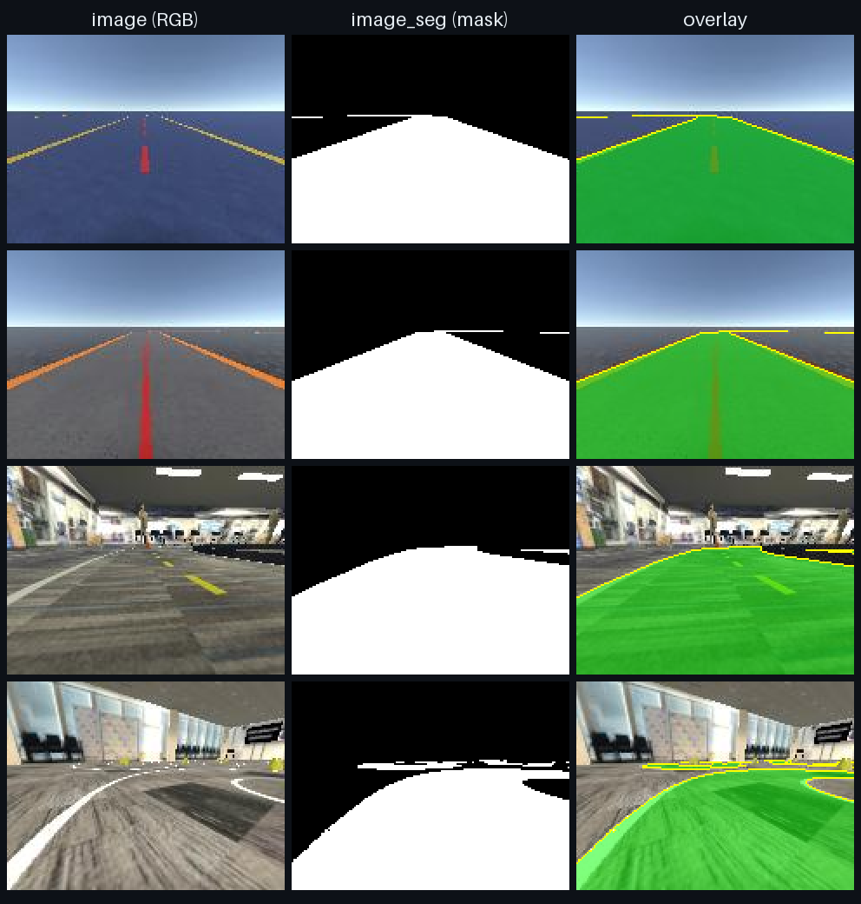
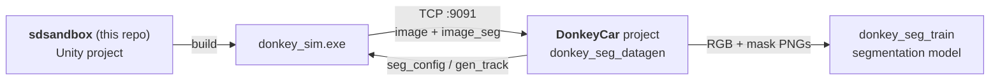

# DonkeyCar Simulator: Road Segmentation Fork

[](https://unity.com/releases/editor/archive)
[](tools/requirements.txt)
[](https://github.com/tawnkramer/sdsandbox)

A fork of the [DonkeyCar Unity simulator](https://github.com/tawnkramer/sdsandbox). It sends a
**pixel-perfect drivable-road mask** along with every camera frame, and it can generate an
**endless supply of seeded, randomised tracks**. Together these produce labelled data for
training road-segmentation models.

<p align="center">
  
</p>

---

## What this fork adds

| Feature | Message | What you get |
|---|---|---|
| **Segmentation camera** | `seg_config` | An extra `image_seg` field in every `telemetry` message: a lossless PNG mask of the *same* frame, with the same size as `image`. **0 = background, 1 = drivable road.** |
| **Procedural tracks** | `gen_track` | A closed-loop track built from a seed: shape, width, surface, line style and colours, and ground. The same seed always gives the same track. The sim replies with `track_info`. |
| **More road styles** | `regen_road` | `road_style` 0–6: asphalt, dirt, cobblestone, sand and more, up from the original 2. |
| **Scene labelling** | – | Existing scenes (`generated_track`, `mini_monaco`, `mountain_track`, `warren`) are labelled at load time. No scene file is edited. |
| **Test tools** | – | `tools/check_seg.py` and `tools/check_trackgen.py`: automatic pass/fail checks plus overlays for a visual check. |

The original RGB pipeline is **unchanged**: `image` is rendered and encoded exactly as before. A
second, hidden camera renders the mask at the same moment, using a replacement shader.

<p align="center">
  
  <br><sub>Green = class 1 (road) and yellow = mask border, drawn on the RGB frame. Every <code>gen_track</code> seed gives a new track.</sub>
</p>

## How it fits together



* **This repo:** the simulator source. Change it here when you need new labels, scenes or track
  variety, then rebuild the `.exe`.
* **[DonkeyCar project](https://github.com/AymaneLaabadi/donkeycar):** the Python side. It drives
  the car, saves RGB + mask pairs (`donkey_seg_datagen`) and trains the model (`donkey_seg_train`).
  It expects the build at `../Builds/Segmentation/donkey_sim.exe`.

Recommended folder layout:

```
DonkeyCar Project/
├── sdsandbox/                         ← this repo
├── Builds/Segmentation/donkey_sim.exe ← your build of this repo
└── DonkeyCar/                         ← data generation + training
```

## Quick start

### 1. Build the simulator

1. Install **Unity 2020.3.49f1** with Unity Hub. Use this exact version to avoid re-importing
   the project and getting noisy diffs.
2. *Add project from disk* → `sdsandbox/sdsim`. The first import takes a few minutes.
3. **File ▸ Build Settings ▸ Build**, and choose the output folder `DonkeyCar Project/Builds/Segmentation/`.
   Name the executable `donkey_sim.exe`.

To try changes without building, open `Assets/Scenes/menu` and press **Play**. The sim then
listens on `127.0.0.1:9091`, just like the `.exe`.

### 2. Collect data

Use the [DonkeyCar project](https://github.com/AymaneLaabadi/donkeycar). Its README covers the
install, the collector keys and the training. In short:

```bash
cd DonkeyCar
uv sync --extra torch
uv run python -m donkey_seg_datagen.collect --split train
```

### 3. Or talk to the sim directly

Any [gym-donkeycar](https://github.com/tawnkramer/gym-donkeycar) client works. Send one extra message:

```python
import base64, io
import gymnasium as gym, gym_donkeycar, numpy as np
from PIL import Image

env = gym.make("donkey-generated-roads-v0",
               conf={"exe_path": "../Builds/Segmentation/donkey_sim.exe"})
handler = env.unwrapped.viewer.handler
env.reset()

handler.blocking_send({"msg_type": "gen_track", "seed": "42"})        # optional: random track #42
handler.blocking_send({"msg_type": "seg_config", "enabled": "1"})     # turn the mask on

def decode_mask(msg):
    """Every telemetry message from now on carries image_seg -> HxW uint8, values {0, 1}."""
    png = base64.b64decode(msg["image_seg"])
    return np.asarray(Image.open(io.BytesIO(png)))[:, :, 0]
```

## Message reference

**`seg_config`**: turns the mask on or off for this connection. It is off by default.

```json
{"msg_type": "seg_config", "enabled": "1"}
```

`image_seg` is a base64 PNG with the same width and height as `image`. **Red channel = class id**;
G and B are 0. Always resize masks with **nearest-neighbour** interpolation.

**`gen_track`**: builds a seeded track in the `generated_road` scene (`donkey-generated-roads-v0`)
and puts the car on the start line.

```json
{"msg_type": "gen_track", "seed": "123"}
{"msg_type": "gen_track", "seed": "123", "base": "dirt", "centre_mode": "dashed"}
```

| Override | Values (leave it out to draw the value from the seed) |
|---|---|
| `shape` | `oval`, `polar`, `s_bends` |
| `road_width` | 3.5 – 13.5 m |
| `base` | `asphalt_grey`, `asphalt_coarse`, `dirt`, `cobblestone`, `sand` |
| `edge_mode` / `edge_inset` | `at_edge`, `inset` (+ 0.03 – 0.15 of the width), `none` |
| `centre_mode` | `none`, `solid`, `dashed` |
| `ground` | `sand`, `grass`, `mud`, `concrete`, `carpet` |
| `return_nodes` | `"1"` adds the centreline nodes to the reply |

The `track_info` reply contains the seed, every parameter that was drawn, the length, the minimum
radius, the drivable band and a `hash`. Store it next to your data so each sample can be traced back to its track.

**`regen_road`** (legacy roads): `{"msg_type": "regen_road", "road_style": "4", "rand_seed": "42"}`,
with `road_style` 0–6.

**Labelling rule:** class 1 covers the road surface from the outer edge of the left edge line to the
outer edge of the right edge line, **lines included**. The start line also counts as road. Grass, kerbs and
sidewalks painted into a road texture are class 0.

## Scene support

| Scene | Road mask | Status |
|---|---|---|
| `generated_road` (+ `gen_track`, `regen_road`) | built by the sim | ✅ verified (`check_seg`, `check_trackgen`) |
| `generated_track` | built by the sim + start line | ✅ verified |
| `mini_monaco` | rule in `SceneSegRules.cs` | ✅ verified (road present in 100 % of on-track frames) |
| `mountain_track` | rule in `SceneSegRules.cs` | 🟡 overlays look right; automatic metric not applicable |
| `warren` | built by the sim | 🟡 labelled, not yet checked |
| `circuit_launch` | – | ❌ lanes exist only in the floor texture |
| `warehouse`, `waveshare`, `roboracingleague_1`, `sparkfun_avc` | – | ❌ not supported |

## Verifying changes

Install the tool dependencies (`pip install -r tools/requirements.txt`). Start the sim (or pass
`--exe`), then run:

```bash
# masks valid, aligned, road visible → PASS/FAIL
python tools/check_seg.py --gen-seeds 1 2 3 --frames 100

# same check on an existing scene
python tools/check_seg.py --env donkey-minimonaco-track-v0

# determinism + no overlapping or folding roads
python tools/check_trackgen.py --seeds 200

# offline preview of track layouts (no sim needed)
python tools/trackgen_ref.py --sheet 0 50
```

`check_seg.py` writes `rgb_*`, `mask_*`, `overlay_*` and `overlay_x4_*` images to `seg_check_out/`.
Check the `overlay_x4` images: the yellow border must sit exactly on the road edge.

> Extended telemetry (`cte`, `pos_*`) must be **on**. It is on by default; you can toggle it in the sim's main menu settings.

## Working on the segmentation

| You want to… | Look at |
|---|---|
| Understand the rendering | [`docs/SEGMENTATION.md`](docs/SEGMENTATION.md) (full design notes) |
| Change how the mask is rendered | `Assets/Scripts/segmentation/SegmentationSensor.cs`, `Assets/Resources/SegReplacement.shader` |
| Mark an object as road | add a `SegLabel` component (`classId = 1`) |
| Label a new scene | **Tools ▸ Segmentation ▸ Report Scene Renderers**, then add a rule in `SceneSegRules.cs` |
| Add a road texture | material → `RoadBuilder.roadMaterials`; if its sides aren't road, add its drivable V-band in `SegRoadStyles.cs` |
| Add a track surface or ground | `Assets/Scripts/trackgen/TrackMarkings.cs` (`Bases`, `Grounds`), ground materials in `Assets/Resources/Ground/` |
| Change the track layouts | `TrackLayouts.cs` **and** `tools/trackgen_ref.py`. They are line-by-line twins with the same RNG, so keep them in sync. Then run `check_trackgen.py` |
| Handle a new TCP message | `Assets/Scripts/tcp/TcpCarHandler.cs` |
| Add the mask camera to a car prefab | **Tools ▸ Segmentation ▸ Add SegCam To Car Prefabs**. Without it, the camera is created at runtime with a warning |

**Workflow:** change the code → press Play in the editor or rebuild the `.exe` → run `check_seg.py` → check the overlays → open a PR.

## Known limitations

* **Fisheye** (`cam_config` `fish_eye_x/y`) only distorts the RGB image. Keep it at 0, or warp the
  mask in Python with nearest-neighbour sampling.
* **`step_mode synchronous` does not work** in this sim version. Use the default asynchronous mode.
  RGB and mask are still rendered back to back for the same frame.
* The second camera (`imageb`) has no mask.
* Two classes only (road / background) for now.

More details are in [docs/SEGMENTATION.md § Known limitations](docs/SEGMENTATION.md#known-limitations).

## Credits

Based on [tawnkramer/sdsandbox](https://github.com/tawnkramer/sdsandbox) (the DonkeyCar simulator)
and [gym-donkeycar](https://github.com/tawnkramer/gym-donkeycar). For the original simulator
documentation (creating tracks, the path manager, the private API), see [`docs/`](docs/README.md) and the
[DonkeyCar docs](https://docs.donkeycar.com/guide/deep_learning/simulator/).
Licensed under the original project's [LICENSE](LICENSE).
